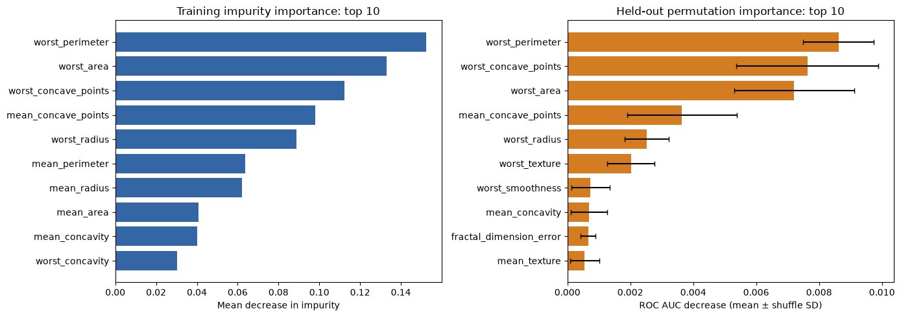
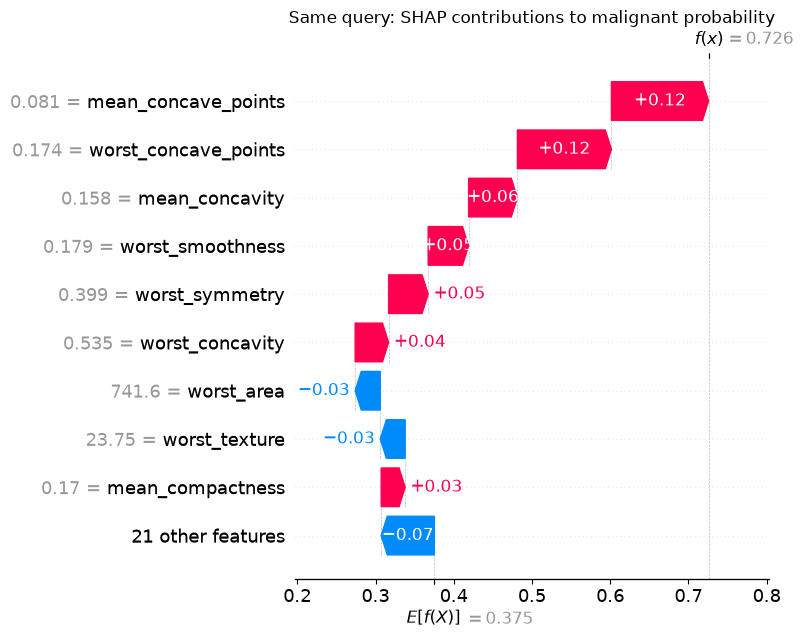
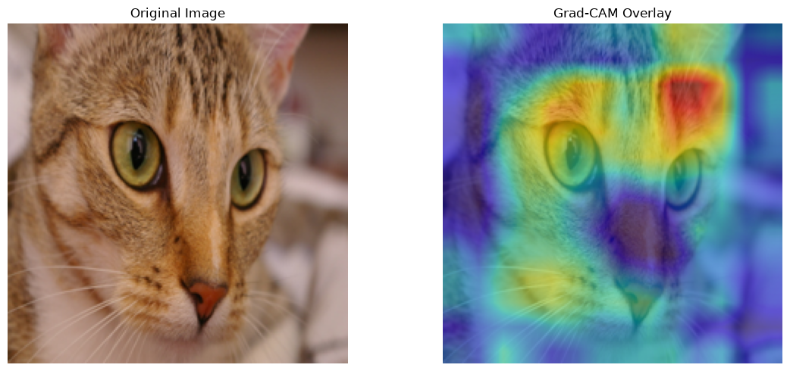
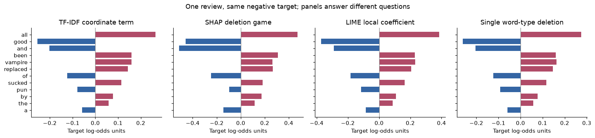
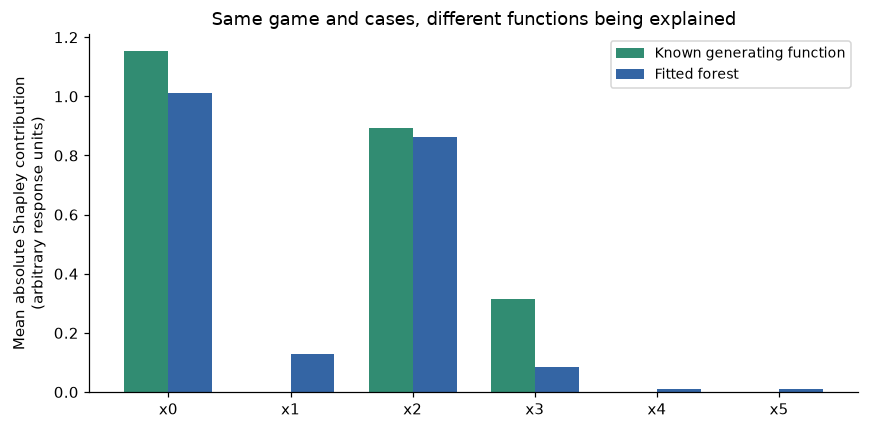

# Introduction to Explainable AI

Learn to choose, run and evaluate XAI methods through reproducible Python
notebooks. Explore interpretable models, feature attributions, response curves,
rules and counterfactuals for tabular, image and text data. Compare methods on
shared cases, examine their limitations, and adapt the examples to your own work.

**New to XAI?** Follow the [beginner guide](docs/METHOD_GUIDE.md): learn the key
terms, read one worked comparison without installing anything, then run it and
check what each explanation supports.

## What is included

- **Worked examples:** explanations alongside the model, data and assumptions
  needed to interpret them.
- **Shared comparisons:** several methods applied to the same tabular, image or
  text case, with differences in their outputs explained.
- **Evaluation tools:** reconstruction checks, sensitivity experiments, failure
  cases and reproducibility records.
- **Learning materials:** a beginner walkthrough, method references, exercises,
  instructor solutions and human-study templates.

## Example outputs

A few plots generated by the notebooks. Open an image for the full-size view, or
follow its notebook link to reproduce it.

### Global feature importance



Two views of the same forest: training impurity importance and held-out ROC AUC
loss after permutation. Their scales differ; error bars show variation across
shuffles. [Explore the shared-case comparison →](Tools/MethodComparison_examples/Shared_Tabular_Case_Comparison.ipynb)

### Explaining one prediction with SHAP

<p align="center">
  <a href="docs/images/shap-local-explanation.png"></a>
</p>

SHAP decomposes the model's prediction for one case into signed feature
contributions. This same case is used across the tabular comparison.
[Open the notebook →](Tools/MethodComparison_examples/Shared_Tabular_Case_Comparison.ipynb)

### Visual explanations with Grad-CAM



Grad-CAM highlights image regions contributing to VGG16's selected class score.
The heatmap describes this model's response; it is not an object segmentation.
[Try the Grad-CAM example →](Tools/GradCAM_examples/GradCAM_example.ipynb)

### One review, several explanatory questions



The model, review and target stay fixed. The panels use different definitions,
so matching signs or similar bars do not establish equivalent explanations.
[Read the text comparison](docs/executed/Tools/TextComparison_examples/Shared_Text_Comparison.ipynb)
or [run its source](Tools/TextComparison_examples/Shared_Text_Comparison.ipynb).

### The model can differ from the generating mechanism



The fitted forest uses a correlated proxy that the known synthetic function does
not directly use. Explaining the forest accurately is different from recovering
that function. [Read the regression benchmark](docs/executed/Tools/Evaluation_examples/Regression_Benchmark.ipynb)
or [run its source](Tools/Evaluation_examples/Regression_Benchmark.ipynb).

## Start here

Learn to **choose, run, evaluate and adapt** an explanation. The first path uses
small bundled or synthetic data and runs on CPU without Java, pretrained-model
downloads, TensorFlow or PyTorch.

```bash
git clone https://github.com/Naviden/Introduction-to-XAI.git
cd Introduction-to-XAI
python3.11 -m venv .venv
source .venv/bin/activate
python -m pip install --upgrade pip
python -m pip install -r requirements-tabular.txt
python -m notebook
```

Open [First XAI Comparison](Tools/Starter_examples/First_XAI_Comparison.ipynb)
and use **Restart Kernel and Run All**. Run notebooks from their own directories.
Each notebook also has an **Open in Colab** button; follow the
[Colab setup note](docs/REPRODUCIBILITY.md#google-colab) for dependencies and local files.
For exact resolved Mac/Linux environments, use the hash-checked lockfiles in the
[reproducibility guide](docs/REPRODUCIBILITY.md).

Prefer to read first? Open the [starter with outputs](docs/executed/Tools/Starter_examples/First_XAI_Comparison.ipynb)
alongside the [beginner walkthrough](docs/METHOD_GUIDE.md#your-first-walkthrough).
More [notebooks with outputs](docs/executed/README.md) are available.
[Recorded evaluation tables](docs/results/README.md)
include raw measurements and assumptions. Source notebooks remain easy to edit.

## Choose a learning path

| Path | Suggested sequence |
| --- | --- |
| **Beginner** | [Guided starter walkthrough](docs/METHOD_GUIDE.md) → [Dimensions with outputs](docs/executed/Theory/Dimensions.ipynb) → [interpretable models](Tools/InterpretableModels_examples/Interpretable_Models_Comparison.ipynb) → [core exercises](Practice/Core_XAI_Exercises.ipynb). The guide includes prerequisites and checkpoints. Running Basics or Dimensions in full is optional and needs packages beyond the lightweight profile. |
| **Practitioner** | [Interpretable models](Tools/InterpretableModels_examples/Interpretable_Models_Comparison.ipynb) → [mixed-data workflow](Tools/PracticalWorkflow_examples/Mixed_Data_Workflow.ipynb) → [evaluation protocol](docs/EVALUATION.md) → [causal recourse](Tools/CausalRecourse_examples/Causal_Recourse.ipynb). |
| **Researcher** | [Evaluation and sensitivity lab](Tools/Evaluation_examples/Evaluation_and_Sensitivity.ipynb) → [regression benchmark](Tools/Evaluation_examples/Regression_Benchmark.ipynb) → [shared image](Tools/NeuralComparison_examples/Shared_Image_Attribution.ipynb) and [text](Tools/TextComparison_examples/Shared_Text_Comparison.ipynb) comparisons → [human-study design](docs/HUMAN_STUDY.md). |
| **Teacher / learner** | [Core exercises](Practice/Core_XAI_Exercises.ipynb) → [separate instructor solutions](Practice/Instructor/Core_XAI_Solutions.ipynb) and [rubric](Practice/Instructor/Core_XAI_Rubric.md). The student TODO cells remain intentionally unfinished. |

## Core comparisons and laboratories

| Notebook | What you learn | Environment |
| --- | --- | --- |
| [First XAI comparison](Tools/Starter_examples/First_XAI_Comparison.ipynb) | Permutation, SHAP and LIME for one forest/case, including local approximation error | Tabular |
| [Interpretable models](Tools/InterpretableModels_examples/Interpretable_Models_Comparison.ipynb) · [read outputs](docs/executed/Tools/InterpretableModels_examples/Interpretable_Models_Comparison.ipynb) | Logistic regression, tree, spline GAM, native EBM with/without interactions and a forest; exact term/logit reconstruction | Tabular (`interpret-core`, no dashboard extras) |
| [Evaluation and sensitivity](Tools/Evaluation_examples/Evaluation_and_Sensitivity.ipynb) | Repeated cases/seeds, correlated features, background/masking sensitivity, random controls and a misleading-shortcut example | Tabular |
| [Regression benchmark](Tools/Evaluation_examples/Regression_Benchmark.ipynb) · [read outputs](docs/executed/Tools/Evaluation_examples/Regression_Benchmark.ipynb) | Three tasks, five repeats each, presampled cases, SHAP Exact/LIME, independent numerical reference, random controls, measured time/calls/traced allocations | Tabular |
| [Mixed-data workflow](Tools/PracticalWorkflow_examples/Mixed_Data_Workflow.ipynb) | Missing values, unknown categories, preprocessing, original-feature grouping and adapting your own model/data | Tabular |
| [Causal recourse](Tools/CausalRecourse_examples/Causal_Recourse.ipynb) | Prediction-flipping inputs versus feasible interventions under an explicit synthetic causal model | Tabular |
| [Shared image attribution](Tools/NeuralComparison_examples/Shared_Image_Attribution.ipynb) · [read outputs](docs/executed/Tools/NeuralComparison_examples/Shared_Image_Attribution.ipynb) | Gradients, input×gradient, IG, DeepLIFT Rescale, ε-LRP, SmoothGrad, occlusion, Grad-CAM, SHAP and LIME on one digits CNN/target | Neural or full; no data/model download |
| [Shared text comparison](Tools/TextComparison_examples/Shared_Text_Comparison.ipynb) · [read outputs](docs/executed/Tools/TextComparison_examples/Shared_Text_Comparison.ipynb) | One TF-IDF classifier and word-deletion protocol for SHAP, LIME, occlusion and Anchors; cohort and stability checks | Tabular + `anchor-exp==0.0.2.0`, or neural/full; bundled reviews |
| [Complete shared tabular case](Tools/MethodComparison_examples/Shared_Tabular_Case_Comparison.ipynb) | Importance, response curves, local attributions, rules, counterfactuals and model comparisons | Full + MERLIN + Java |

The complete tabular case mostly explains one forest. IG uses a separate neural
model, and RuleFit/tree sections fit explanatory surrogates. Their output scales
and meanings differ. The laboratories preserve failed or weak explanations and
explain what their diagnostics can—and cannot—establish. DeepLIFT and LRP use
explicit rules and report reconstruction/relevance residuals; they do not claim
coverage of every variant. Regression cost records distinguish public prediction
calls from arithmetic work and traced allocations from total process memory.

## Individual methods

Browse by method family below, or use the [beginner guide](docs/METHOD_GUIDE.md)
and [detailed reference](docs/METHOD_REFERENCE.md) to choose by question, data type
and model access.

| Area | Examples |
| --- | --- |
| Local feature attribution | [LIME: tabular](Tools/LIME_examples/LIME_tabular.ipynb), [text](Tools/LIME_examples/LIME_textual.ipynb), [images](Tools/LIME_examples/LIME_image.ipynb); [SHAP: tabular](Tools/SHAP_examples/SHAP_tabular.ipynb), [summary plots](Tools/SHAP_examples/SHAP_summary_plot.ipynb), [text/images](Tools/SHAP_text_image_examples/SHAP_text_image.ipynb) |
| Importance and response curves | [Importance comparison](Tools/FeatureImportanceComparison_examples/FeatureImportanceComparison.ipynb), [permutation](Tools/PermutationImportance_examples/PermutationImportance_example.ipynb), [PDP/ICE](Tools/Visual%20Explanation_example/PDP_ICE.ipynb), [ALE](Tools/ALE_examples/ALE_example.ipynb) |
| Rules and counterfactuals | [Text Anchors](Tools/ANCHOR_examples/Anchor_tabular.ipynb) (historical filename), [DiCE](Tools/DiCE_examples/DiCE_example.ipynb), [RuleFit](Tools/RuleFit_examples/RuleFit_example.ipynb), [MERLIN](Tools/Merlin_examples/20NG_example.ipynb) |
| Neural and specialized | [Integrated Gradients](Tools/IntegratedGradients_examples/IntegratedGradients_example.ipynb), [Grad-CAM](Tools/GradCAM_examples/GradCAM_example.ipynb), [attention](Tools/Attention_examples/Attention_visualization.ipynb), [survival SHAP](Tools/SHAP_examples/SHAP_survival_model.ipynb) |
| Practice | [Core exercises](Practice/Core_XAI_Exercises.ipynb) · [read template](docs/executed/Practice/Core_XAI_Exercises.ipynb); [instructor solutions](Practice/Instructor/Core_XAI_Solutions.ipynb) · [read solutions](docs/executed/Practice/Instructor/Core_XAI_Solutions.ipynb); [LIME student exercise](Practice/LIME_Practice_Notebook_student.ipynb). Student TODO cells are intentionally unfinished. |

The method folders include corrected mathematical introductions with primary
references. SHAP, LIME and RuleFit numerical examples are checked automatically.
For evaluation involving people, [the human-study materials](docs/HUMAN_STUDY.md)
provide a protocol, preregistration, participant-information draft and reporting
template. These are study-design materials; no participants or empirical human
study results are claimed.

See [coverage boundaries and selection criteria](docs/METHOD_REFERENCE.md) and the
[roadmap](docs/ROADMAP.md) for remaining families and research extensions.

## Theory and sources

[Basics](Theory/Basics.ipynb) introduces interpretable models and surrogates.
[Dimensions](Theory/Dimensions.ipynb) explores explanation goals, audiences and
presentation through worked examples; a [copy with outputs](docs/executed/Theory/Dimensions.ipynb)
is available for reading. Its taxonomy lesson draws on
[Cambria et al. (2023)](https://doi.org/10.1016/j.ipm.2022.103111), with Figure 1
and full attribution in the notebook. Individual method tutorials cite their
original papers and implementation documentation.

## Full environment and optional tools

Use **Python 3.11**. Resolved profiles target **Apple silicon macOS 14+** and
**Linux x86-64 with glibc 2.28+**; Linux locks select CPU PyTorch. The pinned full neural
packages do not support Intel Macs; Windows has not been validated. Versions are
a tested compatible set, not a promise about every newer release.

```bash
# In the active environment:
# Linux: install CPU PyTorch first to avoid unnecessary CUDA packages:
# python -m pip install torch==2.14.1 --index-url https://download.pytorch.org/whl/cpu
python -m pip install -r requirements.txt
```

Profiles and hash-checked transitive lockfiles cover tabular, neural and full
stacks; [the reproducibility guide](docs/REPRODUCIBILITY.md) lists installation
commands and platform limits. `requirements-full.txt` includes MERLIN and test
tools. **Java 21 is an external prerequisite**, outside Python lockfiles.

The full profile includes TensorFlow and PyTorch because examples use both.
The new foundations, digits comparison and bundled-review text comparison run
offline after installing their packages. Older examples need public data or model
weights on first use. [The asset guide](docs/ASSETS.md) explains the registered
checksums, immutable Hugging Face revisions, cache preparation and offline
verification. A verified file download may not populate a library's native cache.
[Provenance](docs/PROVENANCE.md) records source and reuse information. Explanations
describe model behavior; causal claims require additional assumptions.

**RuleFit** requires Java (tested with Java 21). Its H2O server uses two threads
and up to 2 GB heap; notebooks shut down only servers they start.

**MERLIN** requires additional packages and potentially a C compiler:

```bash
python -m pip install -r requirements-merlin.txt
```

The package is `merlinxai`, imported as `merlin`. PyEDA supplies Espresso.
On recent macOS Clang, its legacy function-pointer warnings may require:

```bash
CFLAGS="-Wno-error=incompatible-function-pointer-types" python -m pip install -r requirements-merlin.txt
```

The extras pin the legacy `pkg_resources` provider used by `stopit`. Graphviz is
needed only if you enable diagram exports. Anchors uses spaCy's English tokenizer;
no separate spaCy model download is needed.

## Validation and reproducibility

```bash
# For the lightweight path:
python -m pip install -r requirements-validation.txt
python scripts/check_worked_examples.py
python scripts/check_links.py
python scripts/check_notebooks.py --validate-only
python scripts/check_notebooks.py --group foundations

# For the complete suite, also install the full/dev/MERLIN requirements and Java:
python -m pip install -r requirements-dev.txt -r requirements-merlin.txt
python -m pytest -q
python scripts/check_notebooks.py --group all
```

The runner uses the active interpreter and a fresh kernel per notebook, executes
all code cells, and fails on errors. It writes executed copies, source/helper
hashes, timings and an environment manifest under `validation/`. Source notebooks
are unchanged. Use `--notebook PATH`, `--output-dir PATH`, `--cache-dir PATH`, or
`--timeout SECONDS` (per cell; default 1200).

Groups are `foundations`, `core`, `deep`, and `special`; `neural` and
`image-training` split `deep` for CI. CI uses the tabular lock for foundations,
the neural lock for neural/image-training, and the full lock for core/special.
It checks worked examples,
local document links, notebook schemas, numerical regressions, asset verification
and execution.
Artifacts are retained for 30 days; committed reading copies/results are durable.
See the [recorded local validation](docs/validation-records/README.md) for the tested
notebooks, dependency environment and execution receipts.

Supported caches are redirected to `validation/cache`. SHAP also uses its package
cache, DiCE may save `adult.zip`, and MERLIN creates local logs/results. These are
ignored by Git. Student exercises are validated as templates, not graded as
completed solutions; instructor solutions execute their own checks. See [the reproduction and publication commands](docs/REPRODUCIBILITY.md).

## Contributing and reuse

If you think a particular explainer is missing, please let me know by opening an
issue, or feel free to add it via a pull request.

Follow the [contribution checklist](CONTRIBUTING.md): a precise question, runnable
example, assumptions, interpretation, validation, failure case and primary sources.

**Original code is [MIT licensed](LICENSE); original teaching text and figures are
[CC BY 4.0](LICENSE-CONTENT.md).** Both permit free reuse, including commercial use,
subject to their terms. Third-party materials retain their own licenses and
attribution requirements; see [provenance](docs/PROVENANCE.md). Some historical
third-party data/image redistribution grants remain unverified. Content hashes
identify assets; they do not grant redistribution rights. Please cite the
repository using [CITATION.cff](CITATION.cff) and credit the original method papers.
